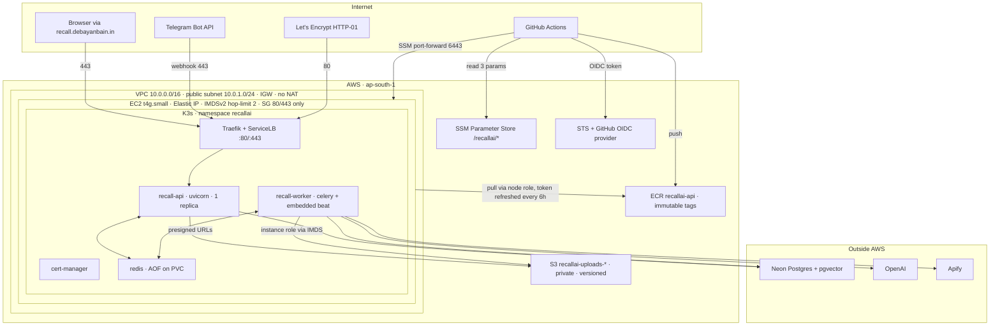
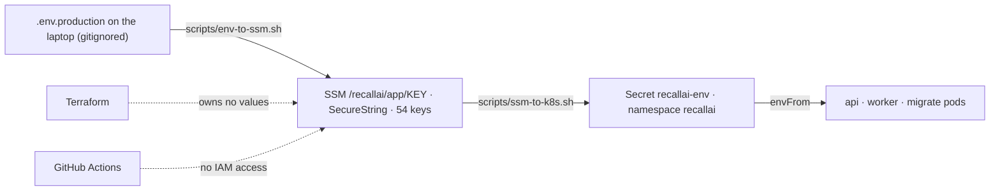
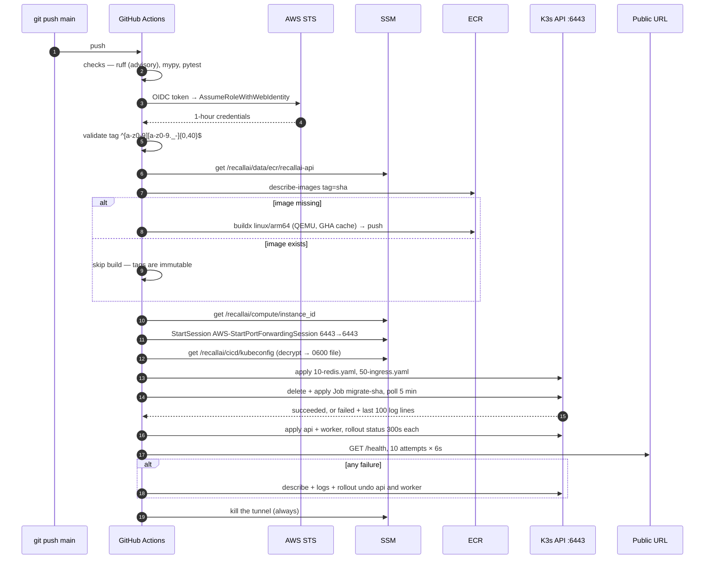

# RecallAI — AWS Deployment

*As of 2026-10-24. Describes what is on `main` and deployed: `infra/`, `k8s/`,
`.github/workflows/`, `scripts/`, `Dockerfile`.*

The backend runs on **one ARM EC2 instance (`t4g.small`) in `ap-south-1`, running single-node
K3s**. Postgres is Neon (managed, outside AWS); user files live in a private S3 bucket reached
through the instance role. A `git push` to `main` builds an arm64 image, pushes it to ECR, runs
migrations as a Job and rolls the API and worker over an SSM tunnel. No AWS key, SSH key or
cluster-admin credential exists anywhere outside the account.

> `infra/README.md` is **stale** — it describes an older plan (`00-foundation/`, a burst EKS
> stack, `ap-southeast-1`, spot instances). This document and the `.tf` files are what is
> actually deployed.

---

## Contents

1. [At a glance](#1-at-a-glance)
2. [Topology](#2-topology)
3. [Why this shape](#3-why-this-shape)
4. [Terraform: five layers, five state files](#4-terraform-five-layers-five-state-files)
5. [The node](#5-the-node)
6. [Kubernetes workloads](#6-kubernetes-workloads)
7. [Secrets and configuration](#7-secrets-and-configuration)
8. [CI/CD pipeline](#8-cicd-pipeline)
9. [Zero to deployed: the runbook](#9-zero-to-deployed-the-runbook)
10. [Day-2 operations](#10-day-2-operations)
11. [Proving what is running](#11-proving-what-is-running)
12. [Troubleshooting](#12-troubleshooting)
13. [Security model](#13-security-model)
14. [Cost](#14-cost)
15. [Known gaps and drift](#15-known-gaps-and-drift)
16. [Reference](#16-reference)

---

## 1. At a glance

| Item | Value |
|---|---|
| AWS account | `179793764711` |
| Region / AZ | `ap-south-1` (Mumbai) / `ap-south-1a` — every Terraform default, the workflow, every script |
| API hostname | `https://recall-api.debayanbain.in` (A record → Elastic IP, managed by hand) |
| Frontend | `https://recall.debayanbain.in` — separate deployment, not in this repo's cluster |
| Node | `t4g.small` (2 vCPU, 2 GB, Graviton arm64), on-demand, Ubuntu 24.04, 30 GB gp3 encrypted |
| Orchestrator | K3s single node, namespace `recallai`, Traefik + ServiceLB, cert-manager |
| Database | Neon Postgres + pgvector, `ap-southeast-1` (~290 ms per round trip from the node) |
| Broker | Redis 7 in-cluster, 1 Gi `local-path` PVC |
| Object storage | S3 `recallai-uploads-179793764711` (private, versioned) |
| Registry | ECR `recallai-api` (deployed), `recallai-web` (provisioned, unused) |
| Secrets | SSM Parameter Store `/recallai/app/*` → Kubernetes Secret `recallai-env` |
| Terraform state | S3 `recallai-tfstate-9eb36356`, one key per layer, S3-native locking |
| CI identity | IAM role `recallai-github-deploy` via GitHub OIDC (repo `debayanbain/recall-ai`, branch `main`) |
| Cluster access | SSM port-forward to `:6443` only — security group opens **80 and 443, nothing else** |

---

## 2. Topology



---

## 3. Why this shape

| Decision | Reasoning |
|---|---|
| K3s on one EC2, not EKS | EKS charges ~$0.10/h for the control plane alone. K3s gives the same API and manifests on one cheap box. |
| No NAT gateway | ~$33/month, more than everything else combined. The node sits in a public subnet; the security group is the boundary. |
| No SSH, no key pair | Session Manager works over an outbound connection. Port 22 is never opened; `aws ssm start-session` is the shell. |
| No public Kubernetes API | 6443 is closed. Humans and CI both reach it through an SSM port-forward. |
| ServiceLB, not an ALB | ServiceLB binds 80/443 on the host and hands them to Traefik. An ALB would bill monthly for one node's traffic. |
| Neon for Postgres | The one thing that must not be lost lives somewhere with backups and branching. |
| Redis in-cluster with `noeviction` + AOF | An eviction policy would silently delete queued tasks. `noeviction` makes the *producer* fail, which the app handles fail-soft. |
| One image, four workloads | `api`, `worker` (+beat), `migrate`, one-off jobs share a digest. A worker running different code than the API is silent and worse than a crash. |
| arm64 end to end | `t4g` node, `linux/arm64` image, Apple Silicon dev machine. What passes locally is what runs. |
| Terraform split by blast radius | Five state files. `destroy` in one layer cannot reach another's resources. |
| Layers talk through SSM, not `terraform_remote_state` | A shell script reads a layer's outputs as easily as Terraform does, and nothing hardcodes subnet or instance ids. |
| Secret values never in Terraform | `terraform.tfstate` is plaintext JSON. Terraform owns no secret values at all. |

---

## 4. Terraform: five layers, five state files

```
infra/
  00-bootstrap/   state bucket + monthly budget            local state, run once
  10-network/     VPC, IGW, subnet, route table, SG        s3://…/10-network/terraform.tfstate
  20-data/        ECR repos + lifecycle, uploads bucket    s3://…/20-data/terraform.tfstate
  30-compute/     EC2 node, EIP, instance role, user_data  s3://…/30-compute/terraform.tfstate
  40-cicd/        GitHub OIDC provider, deploy role        s3://…/40-cicd/terraform.tfstate
```

Apply in that order; each later layer reads the earlier ones' SSM parameters as data sources.
All layers: Terraform `>= 1.10`, AWS provider `~> 5.0`, `default_tags` `Project=recallai`,
`ManagedBy=terraform`, `Stack=<layer>`. Backends use `encrypt = true` and
`use_lockfile = true` (S3-native locking, no DynamoDB table).

### 4.1 `00-bootstrap`

| Resource | Settings |
|---|---|
| `aws_s3_bucket.tfstate` | `recallai-tfstate-<random hex>` — today `recallai-tfstate-9eb36356` |
| versioning / SSE / public-access-block | Enabled / AES256 / all four blocks on |
| lifecycle | Non-current versions expire after 40 days; incomplete multipart uploads aborted after 7 |
| `aws_budgets_budget.monthly` | `$30`/month (`monthly_budget_usd`), emails `alert_email` at **50% actual, 80% actual, 100% forecast** |

State is **local** — something has to create the bucket before there is a bucket to hold
state. Keep that `terraform.tfstate` file. Input: `terraform.tfvars` with `alert_email`.

### 4.2 `10-network`

| Resource | Settings |
|---|---|
| `aws_vpc.main` | `10.0.0.0/16`, DNS support **and** DNS hostnames on (without them ECR pulls fail with DNS errors) |
| `aws_internet_gateway.main` | Attached to the VPC |
| `aws_subnet.public` | `10.0.1.0/24` in `ap-south-1a`, `map_public_ip_on_launch = true` |
| `aws_route_table.public` + association | `0.0.0.0/0 → IGW`. The association is what makes the subnet public. |
| `aws_security_group.node` | Ingress TCP 80 and 443 from `0.0.0.0/0`; egress all. **No 22, no 6443.** |

Port 80 stays open on purpose: Let's Encrypt HTTP-01 needs it, and Traefik uses it to
redirect to HTTPS.

### 4.3 `20-data`

| Resource | Settings |
|---|---|
| `aws_ecr_repository.repo` × 2 | `recallai-api`, `recallai-web`; `IMMUTABLE` tags, scan on push, AES256, `force_delete = false` |
| `aws_ecr_lifecycle_policy.repo` | Untagged images expire after 1 day; keep the newest 10 (`ecr_keep_images`) |
| `aws_s3_bucket.uploads` | `recallai-uploads-<account id>`, **`prevent_destroy = true`** |
| ownership / public-access-block | `BucketOwnerEnforced` (ACLs off) / all blocks on — files leave only via presigned URLs |
| versioning / SSE | Enabled / AES256 |
| lifecycle | Non-current versions expire after 7 days; expired delete markers removed; multipart aborted after 1 day |

The ECR repos were created by hand first and adopted into state, so the settings match what
was clicked.

**Versioning matters to the app:** a plain `DELETE` only writes a delete marker. The storage
client lists every version of the exact key and deletes each by id. Do not "simplify" it to
one `delete_object` (see `CLAUDE.md`).

### 4.4 `30-compute`

| Resource | Settings |
|---|---|
| `aws_instance.node` | `t4g.small`, latest Canonical Ubuntu 24.04 arm64 AMI (from a public SSM parameter), no `key_name` |
| root volume | 30 GB gp3, encrypted, deleted on termination |
| metadata | IMDSv2 required, `http_put_response_hop_limit = 2` (pods are one hop away; with 1 they get no credentials) |
| lifecycle | `ignore_changes = [ami]` (no rebuild when Canonical ships an AMI), **`prevent_destroy = true`** |
| user data | `user_data.sh`, `user_data_replace_on_change = true` |
| `aws_eip.node` | Fixed public IP, so the DNS record survives a node replacement |
| `aws_iam_role.node` + instance profile | Trust: `ec2.amazonaws.com` only |
| managed policies | `AmazonSSMManagedInstanceCore`, `AmazonEC2ContainerRegistryReadOnly` |
| inline `recallai-uploads-rw` | `ListBucket`, `ListBucketVersions` on the bucket; `Get/Put/DeleteObject`, `GetObjectVersion`, `DeleteObjectVersion` on its objects — **that bucket only** |

Outputs: `instance_id`, `public_ip`, `private_ip`, `ssm_command`.

### 4.5 `40-cicd`

| Resource | Settings |
|---|---|
| `aws_iam_openid_connect_provider.github` | `token.actions.githubusercontent.com`, audience `sts.amazonaws.com`. `create_oidc_provider = false` adopts an existing one (one per account per URL). |
| `aws_iam_role.deploy` | `recallai-github-deploy`, 1 h max session |
| trust policy | `aud = sts.amazonaws.com` **and** `sub` `StringEquals` one of the two subjects below; wildcards refused by a variable validation *and* a resource precondition |
| `aws_iam_role_policy.deploy` | See [§13.1](#131-what-ci-can-do-in-aws) |

Trusted `sub` claims (GitHub mints **immutable-id** subjects for this repo):

```
repo:debayanbain@91155437/recall-ai@1341938364:ref:refs/heads/main          # build job
repo:debayanbain@91155437/recall-ai@1341938364:environment:production       # deploy job
```

Two, because a job that names `environment: production` gets the environment form in its
claim instead of the ref form. Set `github_owner_id` / `github_repo_id` to `""` for an
account still on the short `repo:owner/repo:…` format.

Outputs: `deploy_role_arn`, `oidc_provider_arn`, `github_setup` (a ready `gh variable set`
command).

### 4.6 SSM parameter catalog

| Parameter | Type | Written by | Read by |
|---|---|---|---|
| `/recallai/network/vpc_id` | String | 10-network | — |
| `/recallai/network/public_subnet_id` | String | 10-network | 30-compute |
| `/recallai/network/node_sg_id` | String | 10-network | 30-compute |
| `/recallai/data/uploads_bucket` | String | 20-data | — |
| `/recallai/data/uploads_bucket_arn` | String | 20-data | 30-compute (IAM policy) |
| `/recallai/data/ecr/recallai-api` | String | 20-data | deploy workflow (registry URL) |
| `/recallai/data/ecr/recallai-web` | String | 20-data | — |
| `/recallai/compute/instance_id` | String | 30-compute | 40-cicd (IAM scope), deploy workflow (tunnel) |
| `/recallai/compute/public_ip` | String | 30-compute | — |
| `/recallai/cicd/kubeconfig` | SecureString | `scripts/cicd-kubeconfig.sh` | deploy workflow |
| `/recallai/app/<KEY>` × 54 | SecureString | `scripts/env-to-ssm.sh` | `scripts/ssm-to-k8s.sh` (a human), **never CI** |

---

## 5. The node

`user_data.sh` runs once at first boot (log: `/var/log/user-data.log`), in this order:

1. Ensures the **SSM agent** snap is installed and running — the only way in.
2. Creates a **2 GB swapfile**, `vm.swappiness=10`. Without swap an OOM kills a random
   process; with it the box gets slow instead.
3. Installs `curl`, `unzip`, `jq` and the **arm64 AWS CLI**.
4. Installs **K3s** (`server --write-kubeconfig-mode 644 --node-name k3s-node`). ServiceLB and
   Traefik are kept — disable ServiceLB and nothing from the internet arrives.
5. Waits for the node to report `Ready`, copies a kubeconfig for the `ubuntu` user.
6. Installs `/usr/local/bin/ecr-refresh.sh` plus `ecr-refresh.service` / `ecr-refresh.timer`.

**ECR pull credentials with no stored password.** ECR tokens expire after 12 h. The timer
fires 2 min after boot and every 6 h after; it calls `aws ecr get-login-password` with the
node role and re-applies the `ecr-pull` docker-registry Secret in `recallai` (creating the
namespace if missing). The node role is read-only on ECR — it can pull, never push or delete.

K3s defaults that matter here: pod CIDR `10.42.0.0/16` (used by `--forwarded-allow-ips` and
`RATE_LIMIT_EXEMPT_CIDRS`), storage class `local-path` (the Redis PVC lives on the root
volume).

---

## 6. Kubernetes workloads

### 6.1 Manifests

| File | Objects | Applied by |
|---|---|---|
| `k8s/00-namespace.yaml` | Namespace `recallai` | Human, once |
| `k8s/10-redis.yaml` | PVC `redis-data` (1 Gi), Deployment `redis` (`Recreate`), Service `redis:6379` | CI every deploy |
| `k8s/20-migrate-job.yaml` | Job `migrate-<tag>` — `alembic upgrade head`, `backoffLimit: 1`, TTL 24 h | CI every deploy (rendered) |
| `k8s/30-api.yaml` | Deployment + Service `recall-api:8000` | CI every deploy (rendered) |
| `k8s/40-worker.yaml` | Deployment `recall-worker` (`Recreate`, 60 s grace) | CI every deploy (rendered) |
| `k8s/50-ingress.yaml` | Ingress `recall-api` + Traefik Middleware `redirect-https` | CI every deploy |
| `k8s/60-issuers.yaml` | ClusterIssuers `letsencrypt-staging`, `letsencrypt-prod` | Human, once |
| `k8s/70-deploy-rbac.yaml` | ServiceAccount, token Secret, Role, RoleBinding `github-deploy` | Human, once (`cicd-kubeconfig.sh`) |

`__TAG__` in files 20/30/40 is replaced with the image tag by the workflow (`sed`). Every
workload pulls `179793764711.dkr.ecr.ap-south-1.amazonaws.com/recallai-api:<tag>` with
`imagePullSecrets: ecr-pull` and gets its whole environment from `envFrom: recallai-env`.

### 6.2 Commands and probes

| Workload | Command | Probes |
|---|---|---|
| `recall-api` | `uvicorn app.main:app --host=0.0.0.0 --port=8000 --workers=1 --proxy-headers --forwarded-allow-ips=10.42.0.0/16` | liveness `GET /health` (no DB), readiness `GET /ready` (queries the DB only until the first success, then answers from memory — see below) |
| `recall-worker` | `celery -A app.queue.celery_app.celery_app worker -B --schedule=/tmp/celerybeat-schedule --concurrency=1 --loglevel=info` | none |
| `redis` | `redis-server --appendonly yes --maxmemory 48mb --maxmemory-policy noeviction` | readiness `redis-cli ping` |
| `migrate-<tag>` | `alembic upgrade head` | — |

**Readiness proves the database once per pod, not every 10 s.** It used to run `SELECT 1`
on every probe, which kept a Neon free-plan compute from ever suspending and spent its
100 CU-hours/month in about 16 days — the October 2026 outage. Now a pod is NotReady until
it has reached the database once (startup warm-up counts), so a deploy with a bad database
URL still never replaces a working pod; after that it stays Ready through a database blip,
because pulling every pod at once turns a blip into `no available server` on every route.
The beat sweepers (every 5 min) still touch the database, so on Neon's free plan the compute
remains mostly awake regardless.

Beat runs **inside** the worker (`-B`) with one replica and `Recreate`: two schedulers fire
`sweep_stranded_items` twice and race two verdicts onto one row. Never scale the worker past 1
while `-B` is there.

### 6.3 The 2 GB budget

| Workload | Request | Limit |
|---|---|---|
| `recall-api` | 256 Mi / 100m | 400 Mi |
| `recall-worker` | 256 Mi / 100m | 450 Mi |
| `redis` | 32 Mi / 20m | 64 Mi |
| `migrate` Job | — | 256 Mi |

Plus K3s itself, Traefik, cert-manager and CoreDNS, with the 2 GB swapfile as the safety net.

### 6.4 Ingress and TLS

- Host `recall-api.debayanbain.in`, `ingressClassName: traefik`. Routes `/api` (prefix),
  `/health` and `/ready` (exact) to `recall-api:8000`. Nothing else is exposed; `/docs` and
  `/openapi.json` are withheld by the app under `ENV=prod` anyway.
- Annotation `cert-manager.io/cluster-issuer: letsencrypt-prod`; certificate lands in Secret
  `recall-api-tls`. cert-manager renews it automatically.
- `redirect-https` Middleware: permanent HTTP → HTTPS.
- Issuers solve HTTP-01 through Traefik. Use **staging** while testing DNS or redirects —
  production allows 5 certificates per domain per week.

### 6.5 Rate limiting behind the proxy

The API limiter keys on `request.client.host`. uvicorn rewrites that from `X-Forwarded-For`
**only** for peers inside `--forwarded-allow-ips` (the pod CIDR), taking the right-most
untrusted entry. Kubelet probes all come from `10.42.0.1`, so `/health` and `/ready` are
exempt by path and `10.42.0.0/16` by `RATE_LIMIT_EXEMPT_CIDRS`.

> **Never set `--forwarded-allow-ips=*`.** uvicorn would then trust the header's first entry
> verbatim, and anyone could type `X-Forwarded-For: 10.42.0.1` to skip the rate limit.

---

## 7. Secrets and configuration

### 7.1 Flow



- `env-to-ssm.sh .env.production` — one `put-parameter --type SecureString --overwrite` per
  non-empty, non-comment line; strips surrounding quotes; **skips empty values**.
- `ssm-to-k8s.sh` — reads `/recallai/app/*` with decryption and `kubectl apply`s Secret
  `recallai-env` from it. Needs an admin kubeconfig and the tunnel.
- Settings are read once at import (`lru_cache`), and `envFrom` is resolved at pod start. **A
  changed Secret does nothing until the pods restart.**

### 7.2 Production settings that are load-bearing

| Setting | Production value | Why |
|---|---|---|
| `ENV` | `prod` | Turns on every boot guard; withholds `/docs` |
| `FRONTEND_URL` / `CORS_ORIGINS` | `https://recall.debayanbain.in` | Origin allowlist for `assert_same_site`; under `prod` every origin must be `https://` and non-local |
| `PUBLIC_BASE_URL` | `https://recall-api.debayanbain.in` | Telegram and Apify webhook callbacks; must be `https://` when Telegram is on |
| `COOKIE_SECURE` / `SESSION_COOKIE_SAMESITE` | `true` / `lax` | Boot guard refuses `COOKIE_SECURE=false` outside dev |
| `REDIS_URL` | `redis://redis.recallai.svc.cluster.local:6379/0` | In-cluster Service |
| `DATABASE_PROVIDER` | unset → `neon` | `supabase` switches to `SUPABASE_DATABASE_URL` (session pooler, :5432). Data is not synced between them — `scripts/copy_database.py` |
| `DATABASE_URL` | Neon pooler URL with `sslmode` | Normalised to `postgresql+asyncpg` / `ssl=`; boot guard refuses a URL without TLS outside dev |
| `AI_PROVIDER` | `openai` | |
| `B2_BUCKET` / `B2_REGION` | `recallai-uploads-179793764711` / `ap-south-1` | Storage on AWS S3 |
| `B2_ENDPOINT_URL`, `B2_KEY_ID`, `B2_APPLICATION_KEY` | **unset** | Empty endpoint = AWS; no keys = boto3's default chain = the instance role via IMDS |
| `RATE_LIMIT_PER_MINUTE` / `RATE_LIMIT_EXEMPT_CIDRS` | `60` / `["10.42.0.0/16"]` | See §6.5 |
| `SECRET_KEY`, `TOKEN_ENCRYPTION_KEY` | random, set by hand | Boot guard refuses placeholder or short values |

A boot-guard refusal shows up as **`CrashLoopBackOff`** with the reason in the pod log. That is
the app working as designed — read `kubectl logs` before suspecting the cluster.

---

## 8. CI/CD pipeline

### 8.1 Triggers

| Workflow | Trigger | Does |
|---|---|---|
| `.github/workflows/ci.yml` (`checks`) | Every pull request; called by `deploy.yml` | `uv sync --frozen --extra dev`, ruff (**advisory** — 28 pre-existing errors), `mypy app` (strict), `pytest -q` (DB tests skip — no DB on the runner) |
| `.github/workflows/deploy.yml` (`deploy`) | Push to `main` (ignores `**.md`, `docs/**`, `infra/**`); `workflow_dispatch` with optional `image_tag` | checks → build → deploy |

`concurrency: deploy-production`, `cancel-in-progress: false` — one deploy at a time, never
killed midway (that could leave the migration applied and the Deployments not updated).

### 8.2 Sequence



### 8.3 Behaviour worth knowing

- **Tag = commit SHA** (or the `image_tag` input). It is validated by regex because it becomes
  a Kubernetes object name and comes from a typed input; it reaches `run:` blocks through `env`,
  never `${{ }}` interpolation.
- **Re-running a commit is safe.** The build skips an existing image; the migration Job is
  deleted and re-created because a Job's pod spec is immutable.
- **Only the API image is built.** `recallai-web` is never pushed by CI.
- `provenance: false` keeps a single-arch manifest — attestations would add artifacts the ECR
  lifecycle policy counts as images.
- **Rollback on failure:** the API uses a rolling update and keeps the old pod until the new one
  is ready, so a bad image is a failed rollout. The worker is `Recreate` — its old pod is already
  gone. Before the rollout, `Record the running revisions` stores each Deployment's revision;
  on failure only a Deployment whose revision moved during the run is undone, with
  `rollout undo --to-revision=<recorded>`. A failure before the rollout (migration, tunnel,
  kubeconfig) changes nothing, so nothing is undone.
- **Migrations are not rolled back.** A failed rollout after a successful migration leaves the
  schema ahead of the code. Keep migrations backward-compatible with the previous image.
- `environment: production` exists so required reviewers can be added in repo settings to turn
  each deploy into an approval.

### 8.4 Deliberately not in the pipeline

- **Terraform.** A role that can `apply` is an admin role; a compromised workflow would own the
  account.
- **Namespace and ClusterIssuers.** Cluster-scoped bootstrap; the deploy identity cannot touch
  them.
- **Application secrets.** Changed by a human ([§10.3](#103-change-an-application-setting-or-secret)).
- **SHA-pinned actions.** `@v4` follows a moving tag — the hardening step for when the repo has
  more than one writer.

---

## 9. Zero to deployed: the runbook

Each phase is verifiable on its own. Prerequisites on the laptop: AWS CLI v2 + Session Manager
plugin, Terraform ≥ 1.10, `kubectl`, `gh`, `jq`, Docker (optional).

### Phase 0 — Account hardening

1. MFA on root, **zero** root access keys. Create an IAM admin user with MFA; never use root
   again except for billing.
2. `aws configure --profile recallai`, `export AWS_PROFILE=recallai`,
   `aws sts get-caller-identity` must print the admin ARN.
3. Enable Cost Anomaly Detection (free). The budget itself comes in Phase 1.
4. Do **not** create or join an AWS Organization or Control Tower — on the credit-based free
   plan that ends the credits. Watch the **credit balance**, not the bill (it reads $0.00 while
   credits drain).

### Phase 1 — State bucket and budget

```bash
cd infra/00-bootstrap
cp terraform.tfvars.example terraform.tfvars    # set alert_email
terraform init && terraform apply
terraform output -raw state_bucket              # paste into every other layer's backend.tf
```

### Phase 2 — Network

```bash
cd ../10-network
terraform init && terraform validate
terraform plan -out=tf.plan                     # expect no aws_nat_gateway
terraform apply tf.plan
aws ec2 describe-nat-gateways --query 'NatGateways[?State==`available`]' --output text   # must be empty
```

### Phase 3 — Registry and storage

```bash
cd ../20-data
terraform init && terraform apply
terraform output uploads_bucket ecr_urls
```

### Phase 4 — The node

```bash
cd ../30-compute
terraform init && terraform apply
terraform output ssm_command
aws ssm start-session --target "$(terraform output -raw instance_id)" --region ap-south-1
# on the node:
sudo tail -50 /var/log/user-data.log            # ends with "user-data finished successfully"
sudo k3s kubectl get nodes                      # Ready
systemctl status ecr-refresh.timer
```

### Phase 5 — Cluster bootstrap (by hand, once)

```bash
# 1. DNS: A record recall-api.debayanbain.in -> the Elastic IP
dig +short recall-api.debayanbain.in

# 2. Tunnel to the K3s API, in its own terminal (127.0.0.1:16443, reconnects on idle timeout)
make k8s-tunnel

# 3. Admin kubeconfig: fetch the node's over SSM (no scp, no SSH) and repoint it at the tunnel
mkdir -p ~/.kube
ID=$(terraform -chdir=infra/30-compute output -raw instance_id)
CMD=$(aws ssm send-command --instance-ids "$ID" --region ap-south-1 \
  --document-name AWS-RunShellScript \
  --parameters 'commands=["cat /etc/rancher/k3s/k3s.yaml"]' \
  --query Command.CommandId --output text)
aws ssm get-command-invocation --command-id "$CMD" --instance-id "$ID" --region ap-south-1 \
  --query StandardOutputContent --output text > ~/.kube/recallai
sed -i '' 's|https://127.0.0.1:6443|https://127.0.0.1:16443|' ~/.kube/recallai
chmod 600 ~/.kube/recallai && export KUBECONFIG=~/.kube/recallai
kubectl get nodes

# 4. Namespace
kubectl apply -f k8s/00-namespace.yaml

# 5. Application secrets
./scripts/env-to-ssm.sh .env.production
./scripts/ssm-to-k8s.sh

# 6. cert-manager, then the issuers
kubectl apply -f https://github.com/cert-manager/cert-manager/releases/download/v1.16.2/cert-manager.yaml
kubectl -n cert-manager rollout status deploy/cert-manager-webhook
kubectl apply -f k8s/60-issuers.yaml

# 7. Redis and the ingress
kubectl apply -f k8s/10-redis.yaml -f k8s/50-ingress.yaml
kubectl -n recallai get certificate             # READY=True once HTTP-01 passes
```

`~/.kube/recallai` is **cluster-admin**. It stays on the laptop and is never uploaded anywhere.

### Phase 6 — CI/CD

```bash
cd infra/40-cicd
terraform init && terraform apply               # create_oidc_provider=false if the account already has GitHub's
gh variable set AWS_DEPLOY_ROLE_ARN --body "$(terraform output -raw deploy_role_arn)"   # a variable, not a secret
cd ../.. && ./scripts/cicd-kubeconfig.sh        # tunnel + admin kubeconfig required
```

`cicd-kubeconfig.sh` applies `70-deploy-rbac.yaml`, waits for the non-expiring ServiceAccount
token, takes the API server CA from your working kubeconfig, writes a kubeconfig pointed at
`https://127.0.0.1:6443` (the **runner's** forwarded port), verifies it prints
`ok: can patch deployments, cannot read secrets`, then stores it as
`/recallai/cicd/kubeconfig`. The token is never printed.

### Phase 7 — First deploy

```bash
git push origin main
make deploy-logs                                # gh run watch
```

The run ends with `GET https://recall-api.debayanbain.in/health -> 200`. Then point Telegram at
production:

```bash
PUBLIC_BASE_URL=https://recall-api.debayanbain.in make telegram-webhook
make telegram-webhook-info                      # includes Telegram's last_error_message
```

Webhook registration is **global per bot token** — any second environment needs its own bot
from @BotFather, or it silently steals production's updates.

---

## 10. Day-2 operations

### 10.1 Deploy

```bash
git push origin main                            # normal path
make deploy                                     # re-run for HEAD
make deploy-logs
```

### 10.2 Roll back

Tags are immutable and equal to the commit SHA, so a rollback is a deploy of an older tag; the
build step sees the image and skips to the rollout.

```bash
make deploy tag=<previous-commit-sha>           # gh workflow run deploy.yml -f image_tag=<sha>
```

Emergency path with the admin kubeconfig: `kubectl -n recallai rollout undo deploy/recall-api deploy/recall-worker`.
Neither path reverts migrations.

### 10.3 Change an application setting or secret

```bash
# edit .env.production, then:
./scripts/env-to-ssm.sh .env.production
./scripts/ssm-to-k8s.sh                         # tunnel + admin kubeconfig
kubectl -n recallai rollout restart deploy/recall-api deploy/recall-worker
```

**Removing** a key: `env-to-ssm.sh` only writes, so delete it in SSM first, otherwise
`ssm-to-k8s.sh` puts it straight back:

```bash
aws ssm delete-parameter --name /recallai/app/<KEY> --region ap-south-1
./scripts/ssm-to-k8s.sh && kubectl -n recallai rollout restart deploy/recall-api deploy/recall-worker
```

Setting a key to an empty value in the file has the same problem — empty lines are skipped,
so the old SSM value survives.

### 10.4 Get onto the node

```bash
aws ssm start-session --target "$(terraform -chdir=infra/30-compute output -raw instance_id)" --region ap-south-1
sudo k3s kubectl -n recallai get pods
```

### 10.5 Logs

In the cluster, structlog writes JSON to stdout (file logging is hard-gated to `ENV=dev`):

```bash
kubectl -n recallai logs -l app=recall-api    --tail=200 -f
kubectl -n recallai logs -l app=recall-worker --tail=200 -f
kubectl -n recallai logs job/migrate-<sha>
kubectl -n recallai get events --sort-by=.lastTimestamp | tail -30
```

There is no log API and no log table, on purpose.

### 10.6 One-off data jobs

`scripts/` ships inside the image. Copy `k8s/20-migrate-job.yaml`, change `name` and `command`
(e.g. `["python", "scripts/backfill_thumbnails.py", "--apply"]`), keep `envFrom: recallai-env`
and `imagePullSecrets: ecr-pull`, replace `__TAG__` with the running tag, and `kubectl apply -f`.
Used for `backfill_connections.py`, `backfill_thumbnails.py`, `reenrich_language.py`,
`rerun_item.py`.

### 10.7 Health checks of the platform itself

```bash
kubectl -n recallai get certificate recall-api-tls                # READY=True
kubectl -n recallai describe certificate recall-api-tls | grep -E 'Not After|Renewal'
# ECR pull secret: on the node (apply never changes the Secret's creationTimestamp)
#   systemctl list-timers ecr-refresh.timer
#   sudo journalctl -u ecr-refresh --since -7h | grep refreshed
kubectl -n recallai exec deploy/redis -- redis-cli info memory | grep -E 'used_memory_human|maxmemory_human'
kubectl -n recallai exec deploy/redis -- redis-cli llen celery    # queue depth
kubectl top pods -n recallai                                       # metrics-server ships with K3s
```

### 10.8 Replacing the node

This is the most disruptive operation and touches three layers. It is needed for an OS-level
rebuild or **any edit to `user_data.sh`** (`user_data_replace_on_change = true` turns that edit
into a replacement).

1. `prevent_destroy = true` on `aws_instance.node` makes `terraform apply` **refuse** the
   replacement. Remove the line, apply, put it back.
2. A new instance is a new, empty K3s: new cluster CA, no namespace, no Secrets, no cert-manager,
   no Redis data (the `local-path` PVC lived on the old root volume — queued-but-unprocessed tasks
   are lost; `sweep_stranded_items` re-queues `pending` rows from the database).
3. The Elastic IP re-associates, so DNS keeps working.
4. `/recallai/compute/instance_id` updates, but the deploy role's `ssm:StartSession` is scoped to
   the **old** instance ARN until you re-apply 40-cicd: `terraform -chdir=infra/40-cicd apply`.
5. Update the hardcoded id in `scripts/tunnel.sh`.
6. Redo Phase 5 (steps 3–7) and `./scripts/cicd-kubeconfig.sh` — the old kubeconfig in SSM
   points at a dead CA and token.
7. Push or `make deploy`.

---

## 11. Proving what is running

```bash
# image the cluster runs vs what CI pushed for this commit
kubectl -n recallai get deploy recall-api -o jsonpath='{.spec.template.spec.containers[0].image}'; echo
aws ecr describe-images --repository-name recallai-api --region ap-south-1 \
  --image-ids imageTag=$(git rev-parse HEAD) --query 'imageDetails[].imageDigest' --output text
kubectl -n recallai get pods -l app=recall-api -o jsonpath='{.items[0].status.containerStatuses[0].imageID}'; echo

# migration ran for this tag
kubectl -n recallai get jobs                     # migrate-<sha>  Complete (deleted 24 h after finishing)

# last writer was CI's ServiceAccount, not a human context
kubectl -n recallai get deploy recall-api -o yaml --show-managed-fields | grep -B1 -A3 'manager:'

# public endpoint
curl -s https://recall-api.debayanbain.in/health
```

---

## 12. Troubleshooting

| Symptom | Cause | Fix |
|---|---|---|
| `Request ARN is invalid` in `configure-aws-credentials` | `AWS_DEPLOY_ROLE_ARN` is malformed — usually a trailing `%` copied from zsh after `terraform output -raw` | Re-set the variable; check with `gh variable list` |
| `Not authorized to perform sts:AssumeRoleWithWebIdentity` | `sub` or `aud` mismatch — e.g. short vs immutable-id subject, wrong repo name (`recall-ai`, not `recall-ai-backend`) | CloudTrail shows the real `sub` as `userIdentity.userName` (command below); fix `github_*` vars in 40-cicd and apply |
| `Repository variable AWS_DEPLOY_ROLE_ARN is unset` | Phase 6 GitHub step skipped | `gh variable set AWS_DEPLOY_ROLE_ARN --body <arn>` |
| `tunnel never opened` | Instance id changed, role scoped to old ARN, or SSM agent down | Re-apply 40-cicd; check `aws ssm describe-instance-information` |
| kubectl: `connection refused` on `localhost:8080` | `KUBECONFIG` not exported in the step that sets it (`GITHUB_ENV` applies only to later steps) | Already fixed in `deploy.yml` — keep the `export` |
| `/recallai/cicd/kubeconfig is empty` / x509 errors in CI | Kubeconfig never minted, or minted against a previous cluster | `./scripts/cicd-kubeconfig.sh` |
| `Forbidden` applying a manifest in CI | Object kind not in the `github-deploy` Role | Add the verb/resource to `70-deploy-rbac.yaml` and apply it **by hand** |
| `ImagePullBackOff` / `401 Unauthorized` from ECR | `ecr-pull` Secret expired or missing | On the node: `sudo systemctl start ecr-refresh.service`; `journalctl -u ecr-refresh` |
| `CrashLoopBackOff` right after a secret change | Boot guard refusing config (`COOKIE_SECURE`, short `SECRET_KEY`, `*` in CORS, non-TLS DB URL, non-https `PUBLIC_BASE_URL`) | `kubectl -n recallai logs deploy/recall-api --previous` names the setting |
| `alembic upgrade head failed` | Migration error | The step prints the last 100 lines; fix and push. Migrations must be idempotent (see `CLAUDE.md`) |
| `/health` never 200 in smoke test, pods Ready | DNS, certificate or Ingress problem | `dig`, `kubectl -n recallai get certificate,ingress`, `kubectl -n cert-manager logs deploy/cert-manager` |
| Certificate stuck not Ready | HTTP-01 cannot reach port 80, or Let's Encrypt rate limit | Check SG port 80 and DNS; test on `letsencrypt-staging` |
| Pods restart, `/health` answers 429 | Probe traffic rate-limited | Confirm `RATE_LIMIT_EXEMPT_CIDRS` contains the pod CIDR and `--forwarded-allow-ips` is the pod CIDR |
| Telegram silent, API fine | Another environment registered the same bot token | `make telegram-webhook-info`; re-register production; use separate bots |
| Captures stuck at `pending` | Worker down or Redis unreachable | `kubectl -n recallai get pods`, worker logs; the 5-minute sweeper re-queues once it is back |
| `terraform plan` wants to destroy the instance | `user_data.sh` edited, or a non-ignored attribute changed | `prevent_destroy` stops it; see [§10.8](#108-replacing-the-node) before proceeding |

```bash
# the claim STS actually saw
aws cloudtrail lookup-events --region ap-south-1 --max-results 1 \
  --lookup-attributes AttributeKey=EventName,AttributeValue=AssumeRoleWithWebIdentity \
  --query 'Events[].CloudTrailEvent' --output text | python3 -m json.tool | grep -E 'userName|errorMessage'
aws iam get-role --role-name recallai-github-deploy \
  --query 'Role.AssumeRolePolicyDocument.Statement[0].Condition' --output json
```

---

## 13. Security model

### 13.1 What CI can do in AWS

| Statement | Actions | Resource |
|---|---|---|
| `EcrAuth` | `ecr:GetAuthorizationToken` | `*` (cannot be scoped by API design) |
| `EcrPushPull` | layer upload, `PutImage`, `BatchGetImage`, `Describe*` | the two ECR repo ARNs |
| `ReadDeployParameters` | `ssm:GetParameter(s)` | `/recallai/compute/instance_id`, `/recallai/cicd/kubeconfig`, `/recallai/data/ecr/*` |
| `DecryptSsmSecureStrings` | `kms:Decrypt` | `alias/aws/ssm` key, only `kms:ViaService = ssm.ap-south-1.amazonaws.com` |
| `PortForwardToNode` | `ssm:StartSession` | the one instance + `AWS-StartPortForwardingSession` (port-forward only, no shell), with `SessionDocumentAccessCheck` |
| `EndOwnSession` | `ssm:TerminateSession` | sessions |

Not granted: Terraform state, IAM, EC2, the uploads bucket, `/recallai/app/*`,
`ssm:PutParameter` (CI can read its kubeconfig, never rewrite it).

### 13.2 What CI can do in the cluster (`github-deploy` Role, namespace `recallai`)

| Resources | Verbs |
|---|---|
| `deployments` | get, list, watch, create, update, patch — **no delete** |
| `deployments/status`, `replicasets` | get, list, watch |
| `jobs` | get, list, watch, create, patch, delete (re-runs replace `migrate-<tag>`) |
| `pods`, `events`, `pods/log` | read |
| `services`, `persistentvolumeclaims`, `configmaps`, `ingresses`, Traefik `middlewares` | get, list, watch, create, update, patch |
| `secrets`, namespaces, ClusterIssuers, anything cluster-scoped | **none** |

### 13.3 Boundaries, stated honestly

- **The real CI boundary is the OIDC `sub`.** RBAC guards the API, not the kubelet: anything
  that can create a Pod in `recallai` can mount `recallai-env` and print it. So "CI cannot read
  app secrets" holds for the API surface, not for a Pod it deploys. Only `main` can assume the
  role at all.
- **Any pod that reaches IMDS gets the node role** (hop limit 2 is required for the app's S3
  access). That role is limited to one bucket, ECR read and SSM core, on a single-tenant node.
- **IMDSv2 required** blocks the classic SSRF-to-credentials path; the app's own SSRF guard
  (`app/core/net.py`) covers user-supplied URLs. Residual risk is DNS rebinding, closed by egress
  rules, not code.
- **No inbound admin surface:** no 22, no 6443, no Flower, no `/docs` in prod.
- **Images contain no secrets:** `.dockerignore` excludes `.env*`, keys, `k8s/`, `infra/`. The
  container runs as uid `10001`.
- **Encryption at rest:** EBS, both S3 buckets (SSE-S3), ECR (AES256), SSM SecureStrings (KMS).

---

## 14. Cost

| Bills hourly | Free or near-free by design |
|---|---|
| One `t4g.small` | VPC, IGW, subnet, route table, SG |
| One 30 GB gp3 volume | SSM Parameter Store Standard (vs Secrets Manager $0.40/secret/month) |
| One public IPv4 / Elastic IP | Session Manager (vs a bastion) |
| ECR storage (≤ 10 images/repo) | S3-native state lock (vs DynamoDB) |
| S3 uploads storage + requests | K3s (vs EKS ~$0.10/h), ServiceLB (vs ALB), **no NAT** (~$33/month avoided) |

Guardrails: $30/month budget with 50% / 80% actual and 100% forecast alerts
(`00-bootstrap/budget.tf`), Cost Anomaly Detection, ECR and S3 lifecycle rules. Variable costs
sit outside AWS: OpenAI, Apify, Neon.

---

## 15. Known gaps and drift

Found while writing this; none are fixed here.

| Area | Gap |
|---|---|
| Availability | One node, one AZ, one replica each. A node reboot is downtime; a replacement is a rebuild (§10.8). |
| Redis in K8s vs compose | `10-redis.yaml` limit is 64 Mi for `maxmemory 48mb` — **1.33×**, while the project's own rule is a 3× limit because an AOF rewrite forks. It also lacks `--save ""`, `--auto-aof-rewrite-min-size` and `--activedefrag`, which `docker-compose.yml` sets. Low risk while the queue is tiny; an OOMKill mid-rewrite presents as a mystery restart. |
| Termination protection | `ec2.tf` comments say it stops accidental deletion, but `disable_api_termination = false` — protection is **off**. Only Terraform's `prevent_destroy` guards the node. |
| Hardcoded ids | `scripts/tunnel.sh` (instance id), `user_data.sh` and `k8s/2*-4*.yaml` (account id/registry). Everything else reads SSM. |
| Secrets sync | `env-to-ssm.sh` never deletes; removed or emptied keys survive in SSM (§10.3). |
| Migrations | No automatic down-migration on rollback. |
| Frontend | `recallai-web` ECR repo exists; nothing builds or deploys it from here. |
| Observability | No metrics or alerting beyond AWS budgets; logs are stdout only, lost with the pod. |
| DR | Relies on Neon durability and S3 versioning; restore never drill-tested. No EBS snapshots. |
| Latency | API in `ap-south-1`, Neon in `ap-southeast-1`: ~290 ms per statement. Colocating them is the biggest available speed-up. |
| CI hardening | Actions pinned by tag, not SHA; ruff advisory only; DB-backed tests skipped in CI. |
| Docs | `infra/README.md` describes an older design and the wrong region. |

---

## 16. Reference

### Make targets

| Target | Runs |
|---|---|
| `make k8s-tunnel` | `scripts/tunnel.sh` — SSM port-forward node `6443` → `127.0.0.1:16443`, auto-reconnect |
| `make cicd-kubeconfig` | `scripts/cicd-kubeconfig.sh` |
| `make deploy [tag=<sha>]` | `gh workflow run deploy.yml [-f image_tag=<sha>]` |
| `make deploy-logs` | `gh run watch` on the newest deploy run |
| `make telegram-webhook` / `-info` / `-delete` | `scripts/telegram_webhook.py register` / `info` / `delete` |

### Files

| Path | Owns |
|---|---|
| `infra/00-bootstrap/` … `infra/40-cicd/` | AWS resources, by layer |
| `infra/30-compute/user_data.sh` | Node bootstrap: SSM agent, swap, AWS CLI, K3s, ECR refresh timer |
| `infra/40-cicd/README.md` | CI setup, OIDC debugging |
| `k8s/*.yaml` | Cluster objects (§6.1) |
| `.github/workflows/ci.yml`, `deploy.yml` | Quality gates, build and rollout |
| `Dockerfile`, `.dockerignore` | The one image (python 3.12-slim, uv, uid 10001) |
| `scripts/env-to-ssm.sh`, `scripts/ssm-to-k8s.sh` | Secrets: laptop → SSM → Kubernetes |
| `scripts/cicd-kubeconfig.sh` | Mint CI's namespaced kubeconfig into SSM |
| `scripts/tunnel.sh` | Human tunnel to the K3s API |
| `app/core/config.py` | Every setting and the boot guards that refuse bad production config |
